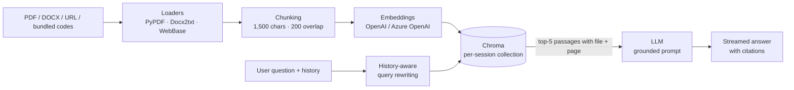

# ⚖️ Moroccan Legal Assistant

> Ask questions about Moroccan law and get answers grounded in the official texts, with a citation (file + page) for every claim.

   

Capstone project (Al Akhawayn University), graded A+.

---

## The problem

Moroccan legal texts are public but hard to use. Codes run to hundreds of pages, live in scanned or poorly structured PDFs, and mix French and Arabic. Students, small business owners and citizens end up relying on forums or on general-purpose chatbots that **invent article numbers** with full confidence.

## Who it is for

| User | Typical question |
|---|---|
| Law / business students | "Which article of the Family Code covers the age of marriage?" |
| Founders and small businesses | "What does the Commercial Code say about a merchant's obligations?" |
| Citizens | "Which constitutional article protects freedom of expression?" |

## What it does

- **One-click corpus**: loads the Family Code, Commercial Code, Penal Code and 2011 Constitution shipped in [`corpus/`](corpus).
- **Bring your own sources**: upload PDF, DOCX, TXT or Markdown files, or index a web page by URL.
- **Grounded answers with citations**: the model answers only from retrieved passages and cites `[file, p. N]`. If the texts do not contain the answer, it says so.
- **Conversational**: follow-up questions are rewritten into standalone search queries using the chat history.
- **Multilingual**: answers in the language of the question (French, Arabic, English).

## Architecture



| File | Role |
|---|---|
| [`app.py`](app.py) | Streamlit UI: API key, model choice, sources sidebar, chat loop |
| [`rag_methods.py`](rag_methods.py) | Loading, chunking, indexing in Chroma, retrieval chain, grounded prompt |
| [`corpus/`](corpus) | Official Moroccan legal texts used for the one-click demo |
| [`docs/PRD.md`](docs/PRD.md) | Product requirements: problem, users, scope, metrics, risks |

## Key decisions and trade-offs

| Decision | Why | Trade-off |
|---|---|---|
| Small chunks (1,500 chars) | A legal article is short; small chunks keep a citation pointing to one article | More chunks to embed (≈1,200 for the 4 codes) |
| Answer **only** from context | In law, a confident wrong answer is worse than "I don't know" | Refuses questions the corpus does not cover |
| Citations as `[file, p. N]` | Lets the user verify against the source in seconds | Page-level, not yet article-level |
| Per-session in-memory Chroma | No database to run; each user's uploads stay separate | Index is rebuilt each session |
| Streamlit | Fastest path from prototype to a shareable demo | Limited UI control, not built for heavy traffic |

## Run it locally

Requires Python 3.12.

```bash
git clone https://github.com/e-1305/Moroccan-Legal-Assistant---RAG-LLM.git
cd Moroccan-Legal-Assistant---RAG-LLM
python -m venv .venv && source .venv/bin/activate   # Windows: .venv\Scripts\activate
pip install -r requirements.txt
cp .env.example .env                                # optional: or paste your key in the sidebar
streamlit run app.py
```

Then open http://localhost:8501, paste an OpenAI API key, click **📚 Load Moroccan legal codes**, and ask a question.

**Deploy your own**: push a fork to [Streamlit Community Cloud](https://streamlit.io/cloud), select Python 3.12, and add `OPENAI_API_KEY` in the app's secrets.

## Limits

- **Not legal advice.** It is a research and learning tool. Always check the official text or a qualified lawyer.
- **Corpus freshness.** The bundled PDFs are snapshots; amendments published after them are not covered.
- **Scanned PDFs.** Pages without a text layer are not extracted (no OCR yet).
- **Arabic retrieval.** Embeddings work across languages, but retrieval quality on Arabic queries has not been measured yet.
- **No evaluation set yet.** Answer quality is checked by hand; see the roadmap.

## Roadmap

- [ ] Evaluation set: 50 FR/AR questions with expected articles; track citation accuracy and refusal rate
- [ ] Article-level citations (split on "Article N" instead of fixed size)
- [ ] OCR for scanned texts, plus more codes (Labour Code, Code of Obligations and Contracts)
- [ ] Hosted public demo
- [ ] Persist the bundled corpus index so it loads instantly

## License

Code under the [MIT License](LICENSE). The texts in `corpus/` are official Moroccan legal texts and are not covered by this license.

---

Built by [Amine Ben Elmahdi](https://www.linkedin.com/in/e1305/).
